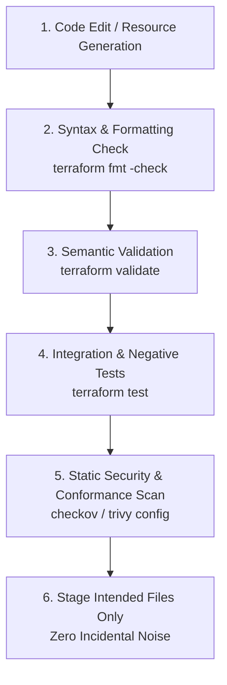

# Autonomous Agent Workflow & Verification Discipline

> **Purpose:** Prescribes the non-negotiable pre-flight verification sequence, commit discipline, and compliance validation an AI coding agent must execute before proposing changes.

---

## 1. Non-Negotiable Pre-Flight Verification Sequence

Before presenting any Terraform/OpenTofu code change, the AI agent MUST execute and verify the following 5 gates locally:



### Gate 1: Syntax & Whitespace Formatting
```bash
terraform fmt -recursive
```
* Agents must verify that formatting changes are scoped strictly to the files edited. Incidental whitespace noise on untouched shared modules must be reverted before committing.

### Gate 2: Provider & Semantic Validation
```bash
terraform validate
```
* Must return `Success! The configuration is valid.` with zero syntax or provider argument errors.

### Gate 3: Integration & Assurance Testing
```bash
terraform test
```
* Where `*.tftest.hcl` files exist, agents must run the native test suite to assert that plans pass invariant checks (e.g. IAM managed policies, subnet boundaries).

### Gate 4: Static Security & Compliance Scanning
```bash
# Static security scanning matching CI/CD gates
checkov -d . --framework terraform
trivy config .
```
* All code must pass clean or reference a documented, approved regulatory exception. Agents must never silently introduce new security scan findings.

---

## 2. Commit Discipline & Clean Diffs

1. **Commit Only on Explicit User Instruction:** Agents should generate, validate, and summarize diffs, but never commit or push unless explicitly asked by the operator.
2. **Exclude Local Artifacts:** Never stage:
   * Local `.terraform/` directories or cache
   * `*.tfplan` or execution plan outputs
   * `*.tfstate` or `*.tfstate.backup` files
   * Unencrypted `.tfvars` containing secrets
3. **Scoped Atomic Commits:** Commits must be grouped logically by subsystem (e.g., `feat(iam): convert litellm role policies to customer-managed policies`).

---

## 3. Transparency & Verification Reporting

When presenting completed work to the human engineer, the AI agent must explicitly state:
1. **What was directly verified** (e.g., `terraform validate passed`, `terraform fmt clean`, `assurance.tftest.hcl passed 3/3 tests`).
2. **What assumptions were made** (e.g., provider versions assumed, existing VPC peering IDs referenced).
3. **Regulatory controls satisfied** (e.g., mapped to NIST SP 800-53 controls AC-6, SC-13).
