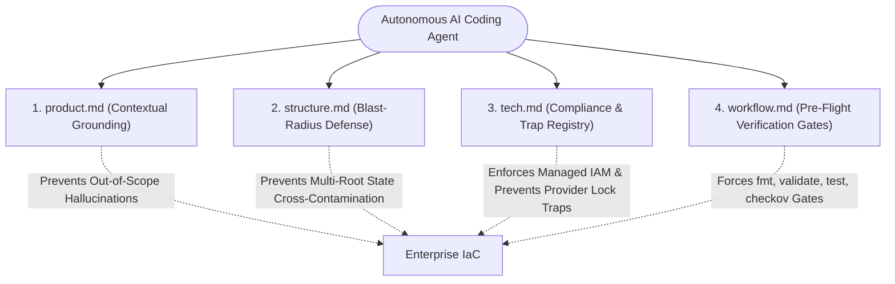

# Enterprise AI Agent Steering Framework for Infrastructure as Code (IaC)

[](.kiro/steering/)
[](adapters/cursor/)
[](adapters/claude/)
[](.kiro/steering/tech.md)
[](LICENSE)

A production-proven **AI Agent Steering & Guardrail Harness** for autonomous coding agents (Kiro, Cursor, Claude Code, GitHub Copilot, Antigravity) operating in high-stakes, regulated enterprise Infrastructure as Code (Terraform / OpenTofu) environments.

---

## 1. The Enterprise Problem: Why Unconstrained AI Breaks IaC

While AI coding agents accelerate software development, letting an unconstrained LLM generate infrastructure code in regulated environments (FinTech, HealthTech, GovCloud, Defense) frequently leads to catastrophic failures:

* 🚨 **Security Regressions:** LLMs habitually generate inline IAM role policies (`aws_iam_role_policy`) and wildcard permissions (`Resource = "*"`), instantly failing enterprise compliance audits.
* 💥 **State Corruption & Lock Traps:** When switching between OpenTofu and Terraform, agents accidentally flip provider registries (`registry.opentofu.org` vs `registry.terraform.io`), causing remote state plans across production environments to fail with `Move Resource State Not Supported`.
* 🔄 **Resource Recreation Cycles:** Agents frequently author inline `ingress`/`egress` blocks inside `aws_security_group` that cross-reference each other, creating circular dependency deadlocks and destructive Terraform recreation plans.
* 💣 **Blast-Radius Cascade:** In multi-root monorepos, agents fail to realize that modifying a shared module can trigger unplanned changes across dozens of downstream production environments.

---

## 2. The 4-Pillar Steering Architecture

This repository codifies the **4-Pillar Steering Architecture** originally engineered for AWS GovCloud platforms running under **NIST SP 800-53 Rev. 5 (Moderate / FedRAMP High)**:

```text
.kiro/steering/
├── product.md       # Pillar 1: Domain context, multi-root boundaries, and regulatory baselines
├── structure.md     # Pillar 2: Multi-root state keys, non-overlapping CIDRs, and blast-radius rules
├── tech.md          # Pillar 3: The Operational Trap Registry & NIST 800-53 / CIS compliance bar
└── workflow.md      # Pillar 4: Autonomous pre-flight verification sequence and commit discipline
```



### Pillar 1: `product.md` (Domain Context & Boundary Defense)
* Grounds the agent in the exact operational scope and account boundaries.
* Establishes regulatory targets (NIST SP 800-53 Rev 5, CIS AWS Foundations Benchmark).
* Explicitly warns agents against assuming commercial AWS parity when working in AWS GovCloud (`arn:aws-us-gov:...`).

### Pillar 2: `structure.md` (Blast-Radius Segregation)
* Instructs agents on navigating multi-root configurations where each platform subsystem maintains an independent remote state file.
* Mandates non-overlapping CIDR allocations across development, staging, and production networks.
* Enforces shared-module immutability to prevent breaking changes on upstream callers.

### Pillar 3: `tech.md` (The "Operational Trap Registry" & Compliance Bar)
* **The OpenTofu Lock Trap:** Enforces strict preservation of `registry.terraform.io` in `.terraform.lock.hcl` files to prevent state provider mismatches.
* **NIST SP 800-53 IAM Conformance (`iam-no-inline-policy-check`):** Hard requirement to use customer-managed `aws_iam_policy` + `aws_iam_role_policy_attachment` pairs with explicit ARN scoping.
* **Security Group Cycle Prevention:** Requires standalone `aws_vpc_security_group_ingress_rule` resources instead of inline blocks.

### Pillar 4: `workflow.md` (Autonomous Verification Pipeline)
* Prescribes the 5-step pre-flight verification loop every agent must execute locally before presenting changes:
  1. `terraform fmt -check` (Syntax & whitespace isolation)
  2. `terraform validate` (Semantic and argument validation)
  3. `terraform test` (Native Terraform 1.6+ assurance testing)
  4. `checkov` / `trivy config` (Static compliance and security analysis)
  5. Scoped staging (Zero incidental whitespace noise on shared modules)

---

## 3. Universal Multi-Agent Adapters

This framework is tool-agnostic and includes pre-configured adapters in [`adapters/`](adapters/):

| AI Coding Agent | Configuration Path | Integration Details |
| :--- | :--- | :--- |
| **Kiro** | [`.kiro/steering/`](.kiro/steering/) | Native 4-document steering specification with LSP settings. |
| **Cursor** | [`adapters/cursor/.cursorrules`](adapters/cursor/.cursorrules) | Root `.cursorrules` file ready to drop into any Terraform project. |
| **Claude Code** | [`adapters/claude/CLAUDE.md`](adapters/claude/CLAUDE.md) | Standard project instruction file for the Claude Code CLI. |
| **Antigravity / Gemini CLI** | [`adapters/antigravity/rules/`](adapters/antigravity/rules/) | Agentic rules and guardrail definitions. |

---

## 4. Operational Reference Patterns

The repository includes concrete code examples demonstrating compliant patterns versus unconstrained agent anti-patterns in [`examples/`](examples/):

* 🛡️ **[`examples/compliant-iam-managed-policy.tf`](examples/compliant-iam-managed-policy.tf):** Demonstrates customer-managed policy attachment vs. non-compliant inline role policies.
* ⚡ **[`examples/cycle-free-security-groups.tf`](examples/cycle-free-security-groups.tf):** Demonstrates standalone ingress/egress rule resources preventing dependency cycles.
* 🔒 **[`examples/provider-lock-hygiene.md`](examples/provider-lock-hygiene.md):** Deep-dive analysis and remediation runbook for the OpenTofu vs. Terraform provider lock mismatch trap.

---

## 5. License & Maintainer

Maintained by **Paul Kanz** (Staff Platform & Infrastructure Architect).  
Licensed under the MIT License.
